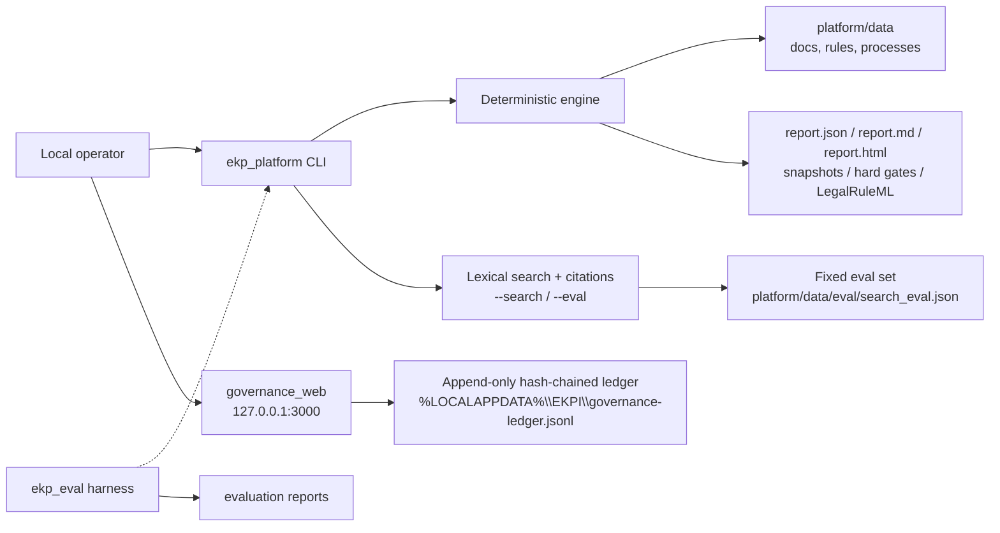

# Architecture

- **Status:** Active; describes the current local prototype
- **Owner:** Engineering
- **Last reviewed:** 2026-10-26
- **Threat model:** [Threat model](threat-model.md)
- **Target security controls:** [governance/07](../governance/07-security-integration-spec-v1.md)

## System context

The current system is a local, offline-capable Rust implementation. It has no server-side database, no enterprise identity provider, no cloud dependency and no live connector. The operator supplies synthetic or authorized non-sensitive data and runs the CLI or the local web workbench.

The dotted `ekp_eval` connection means the platform binary embeds the evaluation runner as a library and emits a comparable `G_ekpi_engine` report. It is not a separate service. `--search` and `--eval` are CLI modes over the same in-process `platform::retrieval` code; they are not a network service and do not add an external dependency.

## Containers and responsibilities

| Container | Location | Responsibility | Current status |
| --- | --- | --- | --- |
| `ekp_eval` library and binary | `eval/` | Case loading, adapters, metrics, reports, self-test | Implemented; offline |
| `ekp_platform` library | `platform/src/lib.rs` | Deterministic engine, data models, process replay, lexical retrieval, search evaluation harness, snapshots, export, governance ledger, web routes | Implemented; mixed served/library-only modules |
| `ekp_platform` CLI | `platform/src/main.rs` | Runs self-test, case evaluation, schema validation, report/coverage/HTML generation, LegalRuleML export, lexical search and the fixed retrieval gate | Implemented |
| `governance_web` binary | `platform/src/bin/governance_web.rs` | Serves the local CSS-first workbench on `127.0.0.1:3000` | Implemented for local, non-sensitive pilot data |
| Seed data | `platform/data/*.json` | 7 documents / 10 versions, 19 active + 1 draft rule, 3 process models | Synthetic fixture |
| Evaluation corpus | `eval/cases/*.jsonl` | 67 cases (9 seed + 46 casebook + 12 edge) | Synthetic fixture |
| Search evaluation set | `platform/data/eval/search_eval.json` | 24 retrieval cases (18 answer, 6 refusal) at threshold 0.42 | Synthetic regression fixture |
| Local ledger | `%LOCALAPPDATA%\EKPI\governance-ledger.jsonl` or `EKP_GOVERNANCE_DATA` | Append-only governance events with a SHA-256 chain | Local prototype, not WORM |
| Generated artifacts | `platform/out/`, `platform/report_out/`, `eval/report_out/` | Reports, snapshots, hard gates, coverage, HTML, LegalRuleML | Generated; not source of truth |

## Module boundaries

The two binaries define the served surface. Modules that are compiled and unit-tested but not imported by either binary are **library-only experiments**. They must not be described as product capabilities until they are wired and have integration evidence.

| Area | Modules | Status |
| --- | --- | --- |
| Deterministic core | `docs`, `rules`, `process`, `retrieval`, `evidence`, `snapshot`, `engine`, `causal` | Served by CLI and tests; `retrieval` is also exposed through `--search`/`--eval` |
| Search evaluation | `eval` (platform module) | Served by `--eval` and integration tests; the separate `eval/` crate is the case-metrics harness |
| Configuration and validation | `params`, `validate` | Served by CLI |
| Output | `export`, `coverage_report` | Served by CLI |
| Governance workbench | `governance`, `governance_web` | Served by `governance_web` |
| Placeholder HTTP API | `api` | **Not served.** `api.rs` returns a fixed `comply` placeholder for `/api/v1/cases/:id/decide`; it is not a contract and must not be exposed |
| Identity and tenancy | `local_auth`, `tenant` | Library-only; **not wired**; no enterprise authentication or tenant enforcement |
| Audit/WORM | `audit`, `worm` | Library-only; the served ledger has its own hash chain but is not WORM |
| Verification and analysis | `formal_verification`, `runtime_verification`, `benchmark` | Library-only |
| Retrieval v2 cluster | `retrieval_v2`, `fulltext`, `reranker`, `vector_search` | Library-only; `retrieval_v2` is not imported by the served path |
| Ingestion and modalities | `bpmn`, `xes_import`, `ocr`, `multimodal`, `knowledge_graph` | Library-only |
| Agents and sidecar | `agents`, `pm4py_sidecar` | Library-only; no LLM or PM4Py call in the served path |

“Library-only” does not mean useless; it means there is no end-to-end evidence for it as a user-facing capability yet. This distinction is part of the no-fabrication rule in [AGENTS.md](../../AGENTS.md).

## Data flow

### CLI adjudication and reporting

1. The CLI reads `platform/data/docs.json`, `rules.json` and `processes.json`, or a directory passed with `--data`.
2. It optionally loads `config/engine-params.json`; invalid or tampered invariants fail closed.
3. `engine` resolves the applicable active rules and document versions, replays process events, retrieves evidence with citations, and produces a decision.
4. `snapshot` records the decision inputs and output so the result can be replayed.
5. `export` emits LegalRuleML; `coverage_report` emits rule coverage; the evaluation runner emits `report.json`, `report.md`, `report.html`, `engine_snapshots.json` and `engine_hard_gates.json`.
6. `--selftest` asserts the expected verdicts, citations and hard gates; it is the CLI's primary integration check.

### Knowledge search and retrieval evaluation

1. `--search QUERY` loads the same document data, builds a retriever from each document's latest version and ranks sections with a deterministic lexical bigram-cosine score.
2. The top five sections are returned with `doc_id`, version, section, score and the verbatim text. Text below the threshold yields `insufficient evidence` and a reason instead of a guessed answer.
3. `--eval --test-set PATH` loads a fixed JSON set (default fixture: 24 cases, threshold 0.42) and runs the same retriever per case.
4. The gate rejects a run with fewer than 10 cases, any failed case, permission isolation below 1.00, or a missing required category (`general`, `ambiguous`, `adversarial`, `wrong_source`, `insufficient_context`). A failed gate exits non-zero.
5. The user identity and role list are supplied only by the library/eval `PermissionContext`. The CLI has no login and applies **no** permission filter; `governance_web` does not call retrieval. The `permissions` field is therefore a library-level filter, not an authorization control.
6. Search is lexical, not semantic or LLM-based. An indirectly phrased question can legitimately return `insufficient evidence`; that is an honest refusal, not a successful answer.

### Local governance workbench

1. `governance_web` opens the ledger path and binds only `127.0.0.1:3000`.
2. GET routes render server-side Maud HTML with CSS only; there is no JavaScript and no client-side state.
3. POST routes append a validated event to the JSONL ledger, then redirect or re-render.
4. Every event carries a sequence number, timestamp, actor, payload, previous hash and SHA-256 hash. The audit page verifies chain continuity.
5. Mutating requests with a foreign `Origin` are rejected before the handler; responses carry CSP, `nosniff`, frame-deny and referrer-policy headers.

## Deployment boundary

There is **no approved deployment target**. The only supported mode is a local process started by the operator. The web server binds to loopback; it is not designed for a shared host, container ingress or public network.

Not currently present:

- PostgreSQL, pgvector, Tantivy, a message queue or a separate search service.
- Enterprise SSO/MFA, tenant isolation or delegated administration.
- Kubernetes, reverse proxy, TLS termination or horizontal scaling.
- Centralized logs, metrics, traces, alerting or on-call.
- Automated deployment, rollback or blue/green release.

The research and selection documents may discuss these technologies. They are options, not current implementation facts. See [tech selection](../tech-selection-round1.md) for the record and [operations](../operations/README.md) for the actual operating mode.

## Capacity and performance assumptions

- Workload: a single local operator, synthetic corpus, in-process deterministic computation.
- Data scale: 7 documents / 10 versions, 20 rule records and 3 process models in the seed fixture; the search regression set adds 24 cases. This is not a capacity model.
- No approved latency, throughput, concurrency or memory target exists. `DEC-19` in the [decision register](../governance/08-decision-register.md) requires an owner-approved capacity model before a performance claim.
- The report records `mean_latency_ms`, but a local mean is not a production SLO. Performance budgets and load tests are Phase B work; see [quality](../quality/README.md).

## Architectural decisions

- [ADR-0001](../adr/0001-engineering-delivery-workflow.md): GitHub Issues workflow, independent crates and reproducible Rust checks.
- [Decision register](../governance/08-decision-register.md): business and control decisions, including identity, data, retention and AI.
- [Decisions index](../decisions/README.md): where new ADRs go and how they are superseded.

## Known architectural gaps

| ID | Gap | Consequence | Tracking |
| --- | --- | --- | --- |
| ARCH-GAP-01 | `api.rs` is an unwired placeholder that returns `comply` with no citations | Must never be exposed; a future API needs a real engine-backed implementation and contract tests | [Reviews improvement register](../reviews/README.md) |
| ARCH-GAP-02 | `local_auth` is not wired into `governance_web` | No authenticated user, role enforcement or access review in the served app | Phase B, `DEC-12` |
| ARCH-GAP-03 | `tenant` is not wired | No tenant isolation in the served app or ledger | Phase B, `DEC-12` |
| ARCH-GAP-04 | Ledger is a local JSONL hash chain, not WORM | Local tamper evidence only; no enterprise retention or external anchoring | Phase B, `DEC-14` |
| ARCH-GAP-05 | No structured logs, metrics, traces or health endpoint for operations | No SLI/SLO or incident detection | Phase B, `DEC-16` |
| ARCH-GAP-06 | Many modules are library-only | Repository size and apparent capability exceed served evidence | Tracked in module table; wire only with a spec and integration tests |
| ARCH-GAP-07 | `permissions` is a library-level retrieval filter, not an authorization boundary | `--search` has no identity and cannot isolate tenants; `governance_web` does not use it | Phase B identity work, `DEC-12` |
| ARCH-GAP-08 | Search is lexical bigram cosine, not semantic or LLM retrieval | Paraphrased questions can abstain; it is not a natural-language answer system | [AI evaluation](../quality/ai-evaluation.md); future retrieval work needs a new ADR and eval set |

## Update triggers

Update this document when a module becomes served or is removed, a container or data store changes, the deployment boundary changes, the data-flow or trust boundary changes, or a capacity assumption is approved. Update the [threat model](threat-model.md) in the same change when the attack surface changes.
