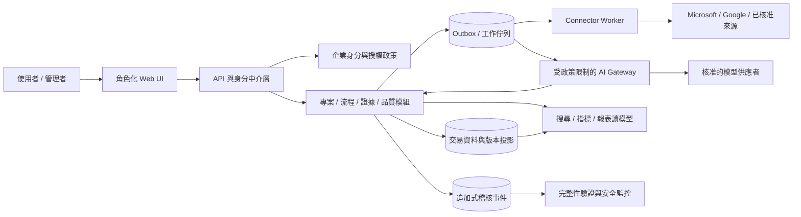

# 身分、權限、安全與連接器規格 v1.0

**狀態：** 正式產品設計基線；Microsoft／Google 租戶的授權、資料區域、功能與其他工具排序仍需現場盤點。未核准前，原型只接受人工來源參照。

## 1. 信任邊界與資料原則

系統資料分成治理中繼資料、文件來源參照、品質／風險資料、身分與權限資料、稽核資料及 AI 輸入／輸出。來源系統仍是文件本體與其原生權限／版本的權威來源。治理系統不得因使用者能看到索引就提升其來源文件權限。

正式環境至少須具備租戶隔離、企業身分驗證、伺服器端授權、傳輸中及靜態加密、密鑰管理、備份／還原、弱點與依賴管理、錯誤監控、管理者稽核及資料刪除／法律保留政策。實際資料分類與法規控制待法遵和資料治理負責人確定，不對未知法規作符合性宣稱。

## 1.1 邏輯元件與責任邊界

| 元件 | 唯一責任 | 主要輸入／輸出 | 不能繞過的控制 |
| --- | --- | --- | --- |
| Web UI | 呈現角色待辦、表單、狀態及驗證訊息 | 受授權 API；不持有連接器秘密 | UI 檢查只改善體驗；服務端仍須驗權與驗狀態 |
| API／身分中介層 | 驗證企業身分、解析角色與租戶／專案範圍 | 使用者命令及查詢 | 預設拒絕、速率限制、CSRF／來源保護、輸入驗證 |
| 專案／流程服務 | 專案、模板、流程實例、階段與關卡規則 | 已授權命令、版本化政策 | 原子驗證前置狀態；發布版與核准記錄不可變 |
| 文件證據服務 | 外部文件版次參照、證據用途連結、來源／審查狀態 | 人工確認或連接器結果 | 來源確認不等於內容核准；版本改變令相關審查失效 |
| 品質／案件服務 | QC、風險、變更、缺失、CAPA 狀態機 | 工作輸出及驗證證據 | 服務端執行型別必填、分離職責、關閉條件 |
| 連接器執行器 | 以受控服務身分查詢來源中繼資料與存取狀態 | 最小範圍供應者 API | 秘密庫、租戶同意、限流、撤權、冪等及錯誤分類 |
| AI 閘道 | 把已核准範圍輸入模型並存草稿／來源 | 模型草稿與未知／矛盾標記 | 專用身分不得呼叫發布／核准 API；輸入依資料政策過濾 |
| 稽核／事件服務 | 追加治理事件、關聯識別碼及完整性驗證 | 所有狀態改變、拒絕與管理操作 | 與一般交易資料權限隔離；失敗需阻擋受控狀態提交 |
| 儲存／搜尋／報表 | 交易資料、事件、索引、指標與匯出 | 已授權讀模型 | 租戶範圍過濾先於搜尋／聚合；敏感欄位遮罩 |
| 營運監控 | 健康、錯誤、備份、延遲、連接器失效告警 | 技術指標與最小化日誌 | 不把文件本體／權杖／個資寫入通用日誌 |

狀態寫入採單一交易語意：服務先驗證身分、授權、狀態前置條件和關聯版本，原子保存業務變更與待送出的稽核事件；事件寫入未確認前不回應成功。外部連接器呼叫不可包在長時間資料庫交易內，採 outbox／工作佇列記錄待辦，回寫同步結果時以冪等鍵和外部版次防止重複。稽核儲存不可用時，安全敏感批准與發布命令 fail closed；不敏感草稿是否可暫存由營運政策定義並須清楚呈現未同步。

### 架構決策草案 ADR-ARCH-001

正式 MVP 採清楚分模組的應用程式核心，先用單一交易資料邊界承載治理狀態、版本、決議與稽核事件；connector 和 AI 呼叫使用隔離的非同步 worker。這保留專案、證據、流程與 gate 的原子一致性，也避免首版拆成難以營運的分散式服務。部署單元／資料庫／雲端供應商待目標環境與 DEC 決議；不可在需求階段以某一供應商專屬資料模型取代領域模型。

需要高可用與擴充時可水平擴展 web／worker；資料按租戶分區，採服務端租戶範圍授權。只有當容量、隔離、發布節奏或故障範圍的量測證明需要時，才拆分獨立服務，並保留 API／事件契約、資料擁有者和交易一致性界線。任何架構拆分須重跑跨服務授權、事件一致性、重試／重播、災難復原及整合延遲驗收。

## 2. 身分與授權

### 驗證

- 企業部署使用經 IT 核准的身分提供者；採 OIDC 或 SAML 的選擇依現行企業架構決定，系統不保存使用者密碼。
- 使用者不可自行以表單輸入的姓名充當身分或核准者。人員欄位存穩定 `subject_id`，名稱作顯示快照。
- 服務帳號／連接器身分與互動使用者分離，具獨立擁有人、用途、權限範圍、憑證輪替、撤銷與到期管理。
- 會話逾時、MFA、條件式存取及帳號離職停用由企業政策核定；未連線／無法確認身分時，所有寫入與核准預設拒絕。

### 授權模型

採角色為基礎權限加上專案、部門、物件與動作範圍。服務端每次請求重新授權，不依 UI 隱藏按鈕作安全控制。

| 動作 | 最低授權角色／範圍 | 分離職責／附加檢查 |
| --- | --- | --- |
| 建立專案 | 專案建立者或 PM | 指定有效贊助人、負責人；限制部門範圍 |
| 修改 G1 後基準 | PM／變更負責人 | 必須建立變更案及影響評估 |
| 加入文件參照 | 專案成員／文件控制者 | 來源存取須獨立核對；不得取代來源 ACL |
| 審查證據 | 指派 QA／審查者 | 避免作者自審；例外需政策明文允許及加註 |
| 修改流程草稿 | 流程擁有者／受委託編輯者 | 只限負責的範圍與版本 |
| 發布流程版本 | 流程擁有者／指定核准者 | 發布者與草稿編輯者分離是否強制由政策決定 |
| 決定 G1–G5 | 指派的關卡核准者 | 驗證所有必備條件、證據版本及未結事項接受權 |
| 關閉重大缺失／CAPA | 指派 QA 驗證者 | 不可由措施執行者自行完成獨立複驗 |
| 管理租戶／連接器 | 租戶管理員或連接器管理員 | 高風險設定雙人審查及稽核 |
| 查看稽核事件 | 稽核者／安全管理者 | 欄位遮罩依資料分類與查詢授權 |

預設拒絕。拒絕事件記錄主體、目標、動作、原因代碼與時間，不在用戶端暴露物件存在與否。定期存取複核週期與權限撤銷時限由 IT 核定。

## 3. 文件來源連接器契約

### 共通 Connector 介面

每個連接器至少提供：

1. `register_source`：來源 ID、租戶／站台範圍、授權狀態、核准權限、連接器版本及負責人。
2. `resolve_reference`：使用來源 ID + 外部物件 ID + 指定版次（若有）取得標題、穩定 URL、可回查歷史版次的定位符、版本識別／ETag、有效／刪除狀態及權限檢查結果；回傳來源提供者 digest（若有）。不下載文件內容，除非另有資料分類核准。
3. `check_access`：以最小必要方式確認當前使用者或指定工作身分可否存取；無法確認時回傳 `unknown`，不得視為 `allowed`。
4. `sync_metadata`：回傳供應方游標／時間、完整性、項目數及錯誤；採冪等更新，保存同步方式為自動或人工。
5. `revoke`／`health`：可停用、撤銷憑證並檢查健康；撤銷後不得繼續重試敏感請求。

錯誤類別至少區分 `unauthorized`、`forbidden`、`not_found`、`version_changed`、`rate_limited`、`timeout`、`provider_unavailable`、`invalid_reference`、`policy_blocked`。重試採供應方限制與有上限退避策略；授權拒絕、無效參照、政策阻擋不可無限自動重試。所有錯誤應保留可供管理者診斷的 correlation ID。

### Microsoft 365 / Google Workspace / 其他工具

每個租戶分別完成工具盤點再選 API；須核對實際產品 SKU、管理者同意、資料區域、共享連結政策、版本 ID 可得性、核准記錄、保留標籤、限流、 webhook／輪詢、撤權與服務帳號政策。此規格不假設任何特定授權已購買，也不要求以全域管理者權限部署。

試點階段由人工維護 `source_system`、穩定來源連結、外部版本、確認者／確認時間，明確標示人工來源確認。平台 MVP 僅在試點證明手動作業造成必要控制缺口後，依優先順序實作連接器；先選工具清冊中頻率、風險與追溯效益最高者，不預設一定同時接通 M365 和 Google。

## 4. API 與可用性行為

- 寫 API 使用版本化契約；每次寫入接受 `Idempotency-Key`，重複鍵與相同內容回傳原結果，鍵重用於不同內容則回 409。
- 資源更新採 ETag／版本號條件更新；版本不一致回 409，顯示最新版本差異並要求重新載入，不能最後寫入者默默覆蓋。
- 驗證錯誤回欄位級錯誤碼與可理解訊息；未登入為 401、無權為 403（可依租戶隱藏物件）、狀態衝突為 409、政策禁止為 422、服務故障為 5xx 並含追蹤 ID。
- 分頁使用不透明 cursor；排序欄位白名單；查詢預設最小欄位集合，禁止未授權跨租戶匯出。
- 連接器不可用時保留排隊／待處理狀態並顯示資料最後確認時間；任何需要即時來源驗證的核准動作須阻擋或由政策明確授權人工替代。
- 服務等級、最大回復時間、復原點、資料容量和可用率均由營運負責人以實際風險核定，不在未評估時填入任意數值。

## 5. AI 資料安全與治理

AI 輸入僅包含完成草稿所需且已核准的資料欄位，不默認上傳文件本體、個資或限制級資料。租戶管理者核准供應者、地區、保留、訓練用途、日誌、模型版本、資料刪除與失效處理；任何一項不明確則關閉該資料類別的 AI 功能。

每份生成草稿保存模型／供應者版本、提示版本、輸入來源引用、產生者、時間、未確認假設及輸出雜湊。具來源的輸入文字僅視為資料，不視為可改變系統安全規則的指令。AI 可提出階段／角色／交付物建議但不建立核准事件；系統權限層需阻止 AI 服務帳號呼叫發布、核准、例外接受與關卡 API。審查者須能查看原始需求片段與 AI 草稿的逐項差異，確認每一階段與關卡條件，對未知／矛盾加註處理結果；「接受全部」不得作為快捷路徑，表單不可預選接受。錯誤／幻覺率需以領域案例集定期測量，回饋應能反映到提示／政策版本，但不得未經版本審查直接改變正式模板。

## 6. 稽核、保留、備份及事件應變

- 稽核事件需可偵測刪改並限制一般管理者覆寫；正式部署定期外部封存／完整性驗證，檢查失敗時告警並凍結受影響放行流程。
- 保留期間依文件類別、合約、司法管轄區、法律保留和個資政策建立矩陣；設定生效前需資料擁有者與法遵核准。到期刪除須記錄範圍、執行者、批次、例外與結果。
- 每類受控文件須明示保存責任屬於來源平台或治理平台；人工連結只保留索引，不保證保存來源內容。上線前測來源平台是否能保留歷史版次、權限／法律保留及期限內可讀取。若不能且業務要求需保留副本，先核定合法依據、分類、最小範圍、加密、存取、保存期、處分及稽核後才允許唯讀副本流程。來源移動／刪除／撤權事件須被偵測；無 webhook 時按 DEC-05 核定的週期做重查，重查未完成顯示 stale，不可保持 verified。
- 備份加密、隔離、定期還原演練，確認事件鏈與來源參照仍一致。還原必須記錄時間點、遺失窗口及修復事件。
- 資料外洩、權限擴大、連接器憑證外洩、版本錯誤或稽核鏈失效均須有分級、通報、保存證據、撤權及復原流程；實際通知時限依組織政策。

## 7. 部署前決策閘門

以下全部有簽署決策與負責人後，才可把原型推進正式平台／接入真實租戶：資料分類與法規適用範圍、身分提供者與角色映射、專案／文件權威來源、連接器 API 與授權、保存／刪除政策、稽核儲存與備份、AI 資料政策、服務水準與維運責任。缺任一項時可繼續非敏感的人工流程試點，但不得宣稱正式控制已就緒。
